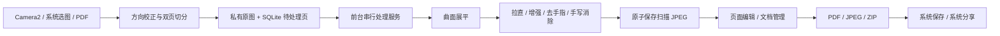

# MyFlat 架构

## 数据流



## 模块职责

- `MyFlatApp` 管理数据库、IO 执行器和可见 Activity 状态。
- `DocumentStore` 用 SQLite 管理文件夹、文档、页序、效果参数和持久化队列。原图和结果文件分别保存，通过 `AtomicFile` 完成结果写入。
- `ScanService` 串行执行 CPU 推理，使用媒体处理前台服务通知。进程退出时保留任务状态，下一次进入 App 将中断的 `processing` 页恢复为 `queued`。
- `Importer` 通过 SAF 读取图片／PDF，不申请广泛存储权限。双页按书脊比例拆分，允许少量重叠。
- `ScanEngine` 只负责图像处理，不依赖资料库 UI。Observer 可保存每个处理阶段的实际图像，Progress 回调报告阶段。
- `PageCanvas` 负责缩放、四角裁剪交互和白纸擦除；`Quad` 在提交裁剪前拒绝自交、凹陷和退化角点。
- `Exporter` 使用 Android `PdfDocument`、JPEG 文件和 `ZipOutputStream` 输出真实文件。PDF 是图像 PDF，不包含识别文本。
- `ShareProvider` 只读开放 `cache/exports` 的直接子文件，通过系统 URI 授权分享，拒绝越界路径。

## 扫描链路

原图先按最长边限制解码与缩放。曲面模型输入为 144 × 192 RGBA；推理结果经 MyFlat JNI 绑定转换为 64 × 64 重采样网格，在 CPU 上重采样并锐化。后续可选拉直模型使用 320 × 320 UV 映射。

色彩增强保留原模型的预／后 LUT 与黑点分类逻辑。去手指同时使用内容蒙版保护印刷内容，白纸直接填充；非白背景使用修补模型。手写消除按 480 × 480 块推理，补白后拼接并恢复原尺寸。

LiteRT Interpreter 按处理阶段关闭，避免同时持有多套模型激活内存。扫描任务串行执行；模型可取消点位于阶段边界和 CPU 行循环，正在执行的一次 native 推理会在返回后响应取消。

## 文件与状态

```text
databases/myflat.db                 SQLite 数据库
files/pages/<uuid>-original.jpg     方向校正后的原始图像
files/pages/<uuid>-result.jpg       扫描或编辑后的结果
cache/exports/<名称>-<时间>.*       用户发起的导出文件
```

数据库实际位于 Android 的 `databases/myflat.db`。文档进入回收站后仍保留原图和结果；永久删除才移除文件。单页删除会删除该页和原图，操作前由界面确认。页面模型重处理从原图开始，手工编辑仅替换结果文件。

## 权限与平台

App 不声明 Internet 权限。相机按需请求；通知用于后台处理进度。API 35 及以上以前台服务类型 `mediaProcessing` 运行，旧版本使用普通前台通知。后台导入保存的任务在下次可见入口恢复，避免从后台违规启动服务。

当前扫描后处理库仅提供 ARM64，其他 ABI 需要系统提供 ARM64 转译。相机拍摄当前以手机竖屏体验为主；自动快门是保守的图像稳定度启发式，并非语义纸张检测模型。
